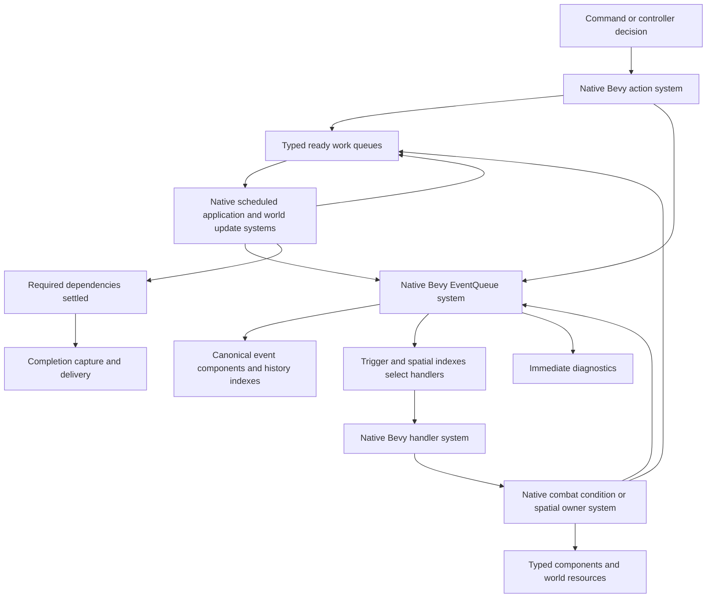

# Bevy Reactive DND Engine Design

The proposed engine uses Bevy ECS for gameplay storage, queries, relationships, component lifecycle, queued work, and native system execution. It preserves reactive causality and rule authority while removing unnecessary synchronous cascades. An intercepted event still has an ordered acceptance result; independent damage applications, lighting changes and sensory refreshes can be queued and processed without making their producer wait for unrelated work. Actions, conditions, movement, perception, and environmental rules retain the responsibilities described in the [language-independent architecture](DND_ENGINE_LANGUAGE_INDEPENDENT_ARCHITECTURE_2026-10-16.md).

The central choices are concrete: creatures, items, tiles, runtime conditions, installed action grants, selected executions, handlers, and retained event versions have native Bevy entities and typed components. Gameplay processors are native Bevy systems. World resources hold typed work queues, indexes, content definitions, random state, encounter state, and history order. Native schedules process ready work; explicit causal dependencies determine when a rule or completion can proceed. There is no universal frame at which all rules suddenly become authoritative.

The mechanism study and executable probes use `bevy_ecs = 0.20.0` without the renderer or the top-level Bevy engine. They establish native execution and queue capabilities plus important observer limitations. They are not a completed gameplay port or a performance comparison. The queue design incorporates the user's clarification that preserving the reactive architecture does not require preserving every serial call in the existing implementation.

The subsequent [condition/handler exposure audit](BEVY_CONDITION_HANDLER_EXPOSURE_AUDIT_2026-10-16.md) inventories all 252 condition declarations and 153 handler construction sites, traces indirect lifecycle integrations, and records exact source-review limits. It refines the ownership, publication and continuation rules below. No reviewed family exposed a public Bevy capability blocker; no complete translated family or parallel speedup is qualified. Direct native translation is the default; an internal alternative is considered only for a demonstrated integration corner, not as a general cleanup agenda.

## 1 Headless world and command boundary

Use one `bevy_ecs::world::World` per independent game. An optional `bevy_app::App` can organize initialization and plugin installation, but the mechanics do not need window, renderer, asset, transform, or real-time update plugins. A host admits a command or controller decision and invokes its native action system, which may submit concrete application work and return an in-progress operation handle.

The host pumps ready work in bounded quanta. An operation is complete only after its required descendants and capture boundary settle; acceptance of the command can return earlier. A rule requiring an accepted child result waits for that dependency, while unrelated queued work can progress. A synchronous host adapter can drive the same operation to completion. Encounter systems advance DND turns and rounds explicitly; Bevy's internal change ticks and host pump iterations are not game time.

Authoritative commits within one game can remain sequential initially without making every cascade a synchronous producer call. Native schedules and parallel computation can exploit independent work with their actual access constraints. Different worlds are independent. Shared reaction resources, condition graphs and cast claims retain explicit deterministic ordering.



The runtime remains reactive. Some accepted-result calls can be nested; other consequences are explicit queued work. Module dependencies remain a directed acyclic graph in either case.

| Ready work or consumer | What it actually waits for |
| --- | --- |
| Next interceptor for one event | The prior interceptor's accepted result, including its required child admission. |
| Damage application to A | A's save/interception and relevant shared claims; not B's unrelated lighting refresh. |
| Breakage consequence | Admitted destruction, then committed geometry/propagation updates. |
| Next Fireball reach stage | Its relevant barrier destruction and propagation revision; not every observer's sight. |
| Observer refresh | Relevant committed geometry, illumination and capability inputs for that observation boundary. |
| Next movement step/guard | Its attack/interception result, actual position and the knowledge/capability it consumes. |
| Completed operation delivery | Its required application, reaction and observation work; not every queue in the world. |
| Host responsiveness | A bounded processing quantum; game work remains explicitly pending. |

## 2 Storage follows actual gameplay identity

| Runtime thing | Native Bevy data | Important ownership distinction |
| --- | --- | --- |
| Creature | `Creature`, stable domain ID, `Abilities`, `Skills`, `SavingThrows`, `Health`, `Equipment`, `Inventory`, `ActionEconomy`, `Spellcasting`, `Senses`, `SpatialPresence`, progression data. | A creature composes systems; monster and class names do not create an inheritance hierarchy. |
| Item | Stable item ID, `ItemDefinition`, `ItemLocation`, optional `Integrity` and `Health`, charge pools, equipment/property configuration. | Holder, container, intrinsic owner, physical support, caster attribution, and sustainer are different links. |
| Tile | Stable tile ID, `TilePosition`, semantic surface, movement costs, elevation, optical/propagation policy, lighting and condition ownership. | Tile entities represent current rule-bearing cells. They do not become renderer entities. |
| Connector | Authored/runtime IDs, endpoints, access/cost/provocation configuration, enabled state. | Endpoint support and mechanical availability remain explicit. |
| Runtime condition | Stable condition ID, membership, duration, contribution gate, graph links, and typed rule payload such as Shield, Concentration, PressurePlate, or GasCloud. | Existence, effective contribution, membership, and source provenance remain distinct. |
| Installed action grant | Grant ID, recipient/provider links, typed action configuration, source item/restraint/spellcasting source, dispatch order. | A definition, installed grant, selected invocation, and recorded action lineage remain separate. |
| Selected action execution | Exact action UUID, selected grant/provider and configuration, evolving cast/sustain state, execution status. | Another native system can resolve this exact invocation while its cast is active. |
| Handler | Stable handler ID, trigger data, mutable dispatch rank, enabled/toggle/suppression policies, installing owner and typed processor registration. | Selection membership and the lifetime of an already selected handler are distinct. |
| Retained event version | `EventHeader` plus the corresponding typed payload component. | One canonical live record is available to nested systems and retained independently of its source actor. |

A creature builder inserts an appropriate `Bundle` and installs the configured grants and features through composition systems. Bundles are construction groupings; rules subsequently query components. A goblin sorcerer and a summoned goblin use the same relevant components with different data and ownership links.

Actor-owned limited-use resources remain component data. The source engine's `Resource` for Rage or Second Wind does not become a global Bevy `Resource`. Likewise, not every numerical modifier needs a separate entity: value components can contain their typed contribution maps and exact modifier IDs.

Statistics blocks initially retain useful existing boundaries. Their independently addressable value IDs and optional condition-owner capability are preserved without automatically creating another entity for every source-language block object. Most authored condition memberships are on creatures, items, tiles, or independent spatial owners.

## 3 The grid is an index over native world data

Choose tile entities because tiles already have identity and rule ownership. A `Grid` resource maps coordinates to tile entities, indexes committed creature/object occupancy and spatial footprints, and stores the current dependency/revision structures. Dense or sparse acceleration buffers for pathfinding and sight are derived caches, with explicit invalidation; they are not another source of tile authority.

Preserve the current objective coordinate, support-height, and occupancy-layer model. This proposal does not implement the separate XYZ plan. Directed boundaries retain distinct movement, optics, propagation, and contact-passage policies. Bevy renderer transforms or a physics plugin do not replace those DND rules.

Position commitment is one small native system. With queued publication it can use ordinary `Query` access to presence/occupancy and `ResMut<Grid>`; an exclusive seam is needed only when the chosen implementation actually requires broader world access. It validates the operation, updates creature presence and grid membership together, and only then submits departure and arrival facts. Both event handlers see the committed new world. A tile or item storage hook must not emit gameplay entry merely because a provisional bundle was inserted.

## 4 Relationships represent specific meanings

Use typed native `Relationship` components for unique links where maintained reverse indexes are useful: item stored in container, condition applied to recipient, handler installed by an effect, or action grant owned by a creature. Use separate relationship types for separate meanings. `ChildOf` is not a universal gameplay-owner field.

Shared condition parents require an explicit set of parents and reciprocal child data, or typed edge entities if that proves useful. A single Bevy relationship component has one target and cannot represent all additional parents on a shared effective condition. Start with explicit graph components matching the current parent/additional-parent/cross-owner relationships; graph mutation remains in the condition systems.

Automatic linked despawn is limited to unshared implementation-owned records after domain removal has been admitted. It does not decide a vetoable condition removal, a shared child's survival, summon departure, destruction of an item into a retained wreck, or whether a vent's existing gas cloud continues after the vent ends.

Retain stable domain IDs and recorded source/effect provenance even when an optional live Bevy entity link disappears. A condition can outlive its caster, and old events survive participant retirement. External recordings and SDK data use domain identities, not serialized Bevy entity bits.

Distinguish leaving active gameplay indexes from destroying retained record storage. Current condition events retain a readable condition after removal; event payloads can retain composed values after their former owner's registry entry is removed. Keep the corresponding typed condition record and event-owned/shared value records accessible for their actual retained lifetime, while removing active membership, contribution, spatial and dispatch components/indexes immediately at the admitted boundary. Retire an owner's own contribution maps exactly as the source does; do not freeze their old bonuses or conflate them with an event's separately composed maps. An old UUID pointing to a despawned component is insufficient. Records needed by retained history can remain until that history is reset; earlier reclamation requires demonstrating that no retained mechanic or capture path needs their data. Retention alone also does not restore active grant or contribution authority.

## 5 Retained event versions are canonical native entities

The source engine retains individually identified event versions and exposes the same live records to nested mechanics. Making those records native entities is justified by that actual lifetime and addressability. They are not disposable mailbox notifications or extra actors in the scene.

An `EventHeader` contains category, phase, domain version/lineage IDs, source/target identities, causal links, turn identity, and publication/cancellation facts. The payload is typed, for example `AttackEvent`, `TakeDamageEvent`, `DamageAppliedEvent`, `ConditionApplicationEvent`, `SpatialChangeEvent`, or `AreaReachEvent`. Phase is header data; advancing phase does not require changing payload archetype.

The `EventHistory` resource stores publication order and lookup indexes referring to those entities. It does not retain a second detached copy of their authoritative payload. A native rule can read the current parent by identity, publish a child, update causal bookkeeping, and continue reading the same canonical parent.

Where successive versions share a live value in the current mechanics, retain an explicit value handle. Do not assume cloning every payload into an immutable snapshot is behaviorally equivalent. Detached public recording is produced at its existing capture boundary, using the corresponding evidence, rather than imposed on every live handler input.

Event entities have explicit history retention/reset lifetime. They are not lifetime children of the acting creature, the causal parent, or an installed condition. Removing a creature must not delete the event record that describes its death or the evidence another rule still needs.

Unpublished proposals and per-handler committed views are deliberately different from published canonical records. They can use temporary native records or owned typed input data, but they never enter the publication-order/UUID indexes until the corresponding explicit publication operation accepts them.

For a committed execution/effect notification, create a separate deep working view for each handler. The view carries the original domain event identity and a canonical-event handle, while its mutable payload and nested value state are isolated. Returned cancellation/replacement values are ignored and the next handler receives a fresh view from the committed record. Any child event resolves its causal parent through the original published domain identity, not the temporary view's Bevy entity. Discard that working view after its logical invocation settles, including any required queued result; submitting work does not end its lifetime. Merely sharing mutable canonical Value IDs with this view would violate the current deep-copy isolation.

Ordinary condition-application Effect has a third, narrower working-view policy: the source uses a shallow unpublished per-handler view so a returned cancellation stays unpublished until provisional contributions are rolled back. Preserve its nested value/reference sharing, while keeping scalar/replacement/cancellation publication under that admission rule. It is neither direct mutation of a canonical Attack payload nor deep isolation of a committed fact. The publication mode selects the corresponding view policy.

For preflight, the proposal remains unpublished and validators may change it, but publishing child events is prohibited by the existing preflight context. Admission and publication are separate operations; creating an ECS storage record is not itself history publication.

## 6 Processors are native Bevy systems

Ordinary handler processors use `Query`, `Res`, `ResMut`, `Commands`, and a typed `In` identifying the handler invocation and current event/view. Their output identifies an accepted replacement event version when one was produced, or records a pending dependency. In-place Attack-style changes with no replacement modify the canonical payload component directly; the explicit working-view modes above retain their different acceptance/isolation policy.

Installed configuration/counters and per-invocation pending state are distinct components. One installation can serve another event while an earlier invocation waits. Concrete domain entry points also include membership/placement changes, landing, removal participants, graph-settled hooks and pre-completion repair; expose them as native systems with their actual result/timing contract. Component storage hooks cannot replace vetoable domain operations or return their accepted results. Native `Commands::run_system_with` accepts owned input but supplies no typed output to the producer and executes exclusively; queued accepted-result mechanics need explicit result records.

For example, a leaf roll-result modifier can be a native system receiving event/handler entity handles and querying that recorded roll plus its source configuration. Shield needs an actual dependency: its current processor changes incoming AC, spends resources, runs condition application, then changes the attack outcome. In a queued translation, a typed `ShieldReaction` record waits for that condition result while the attack's interception cursor waits for Shield. Other ready work can run. Inserting a buff command and accepting the outcome before condition admission finishes would lose the dependency.

Small systems that need a child operation's accepted result within their invocation can use Bevy's supported exclusive-system form with `&mut World` and native `QueryState` or `SystemState`. Condition graph admission/commitment and position commitment are examples. They release component/resource borrows before another native call and re-query afterward. A producer with independently processable consequences instead submits typed requests; its execution data survives in components rather than a blocked stack frame.

This is not an exclusive observer: Bevy rejects an observer system taking full `&mut World`. It is ordinary native Bevy `System` execution used for a synchronous owner operation. The exclusive portion is at the reactive coordination seam; component data and narrower rule processors remain queryable native ECS data/systems.

The compiled mechanism proof also demonstrates the direct source-style interface, independently of event-entity storage:

```rust
fn in_place_no_replacement(
    (InMut(attack), In(owner)): (InMut<Attack>, In<Entity>),
    actors: Query<&ActorResources>,
) -> Option<Attack>
```

Bevy can therefore expose both a borrowed mutable input and a replacement return. The proposed canonical-record design normally passes event handles so nested parent lookups read current ECS data instead of requiring a detached-copy reconciliation protocol.

## 7 Native execution and the optional synchronous reentry seam

The primary cascade path uses typed queued requests consumed by ordinary persistent native systems in schedules. Their next invocation processes the next ready request, so reentering the same active system is unnecessary. A pressure plate commits its edge and retains the selected output list and cursor as typed work. It releases the next output when the preceding output's required result exists; the portal's occupancy/release work therefore settles before the original press resumes with output two. Enqueuing every pulse into a flat FIFO immediately would not preserve this dependency. Remaining press pulses survive even after the plate has released.

There can still be small accepted-result operations for which direct nested execution is useful. The following mechanism proves such calls are possible with public Bevy APIs; it is an optional compatibility seam, not a requirement to serialize all work or a second scheduler.

Calling the same active registered `SystemId` synchronously is insufficient. Bevy temporarily takes that system out of its registry slot while it runs; recursive invocation of that same ID returns `SystemMissing`. Queuing a recursive command until the system returns is a different execution order from the pressure plate or a handler continuing after a child action.

If retaining one of these reentrant processors, use the native `System` abstraction directly. A small per-world cache can retain inactive initialized Bevy system instances for an executable processor registration/factory. Several installed handler entities can use that processor; their separate configuration and owner state are supplied by their entity handles rather than held in the cache:

1. Take an inactive native instance, ending the cache's resource borrow.
2. If all instances are active, create and initialize another instance through `IntoSystem`.
3. Run it with `System::run(input, world)`.
4. On success, return the instance to the inactive cache if the executable processor registration still exists. Ending one installed handler does not necessarily remove a processor shared by other handlers.
5. On an execution error, discard that instance and propagate the existing failure; do not reuse deferred buffers that may contain unapplied commands.

A recursive call uses another inactive instance or initializes one. It does not clone the game, defer the mechanic, or invent a continuation workflow. After the child returns, the original system continues on its original call stack. Bevy owns the system parameter validation, access/query state, and command application. Discarding a failed native instance prevents dirty command-buffer reuse; it does not roll back world changes already committed by that invocation.

Only Bevy execution/query state is cached here. Per-creature, condition, item, cast, and handler gameplay state lives in components/resources. `Local` gameplay flags, message-reader cursors, and `Added`/`Changed` filtering cannot depend on whichever inactive instance happened to be chosen. Request-time contextual evaluation receives its explicit evaluation context.

Standalone ECS also needs native tracker maintenance. At the appropriate outer operation boundary, maintain Bevy's change/removal trackers separately from DND turns. When `World::check_change_ticks` returns a maintenance event, forward its change-tick adjustment to cached native systems through `System::check_change_tick`; a system held in this resource cache is not automatically discovered through a schedule or the registered-system registry. This is library bookkeeping, not a new gameplay tick.

The executable probe establishes this with two recursive outer pressure operations: two native system instances initialize for the two concurrent depths; the second outer operation reuses both. It also reuses a native `QueryState` after an archetype change. It does not establish whole-engine performance. `RunSystemOnce` is used to make initial proofs concise, but Bevy documents its per-call initialization as inefficient; it is not the proposed universal production execution path.

## 8 EventQueue remains the DND publication system

Implement publication/dispatch through native Bevy systems receiving the event entity and explicit publication mode. Their resources are history/index tables, dispatch metadata, and operation/turn context. Small atomic publication operations can use an exclusive system. An event's `EventDispatch` component retains its selected handler snapshot, cursor, accepted version and pending accepted-result dependency when a handler submits queued work. A `ShieldReaction` or similar pending record belongs to that particular invocation, not the shared installed handler: another event can reach the same handler while it waits. No active Bevy system instance or world borrow is retained across the wait. The publication service contains no attack, spell, or material implementation.

Ordinary intercepted publication performs the existing operations:

1. Validate the submitted version's identity and publication state.
2. Capture the required event-time observation grants.
3. Index the canonical event version and causal relationships.
4. Notify immediate passive consumers at the existing storage boundary.
5. Snapshot matching handler registrations in the existing discovery order.
6. Invoke the next selected native handler against the current accepted event.
7. Preserve live enabled, suppression, and trigger checks at invocation.
8. Record accepted replacement versions; stop on a cancellation for this mode.
9. If the handler needs an admitted child result, leave this dispatch pending until that result makes it ready; unrelated events/work can advance.
10. Expose the final accepted event entity to its waiting owner when the chain finishes.

Completion skips ordinary interception. Preflight, accepted-preflight publication, committed execution/effect publication, completed facts, and completion sequences remain explicit separate modes with the authority described in the architecture document. Explicit committed-notification dispatch ignores returned replacements/cancellations; this is not a property inferred from an event being factual or post-commit. In particular, DamageApplied advances through ordinary mutable dispatch after HP commits, accepting body_release and concentration_broken annotations. Such annotation changes do not undo committed HP. Preflight still prohibits child publication rather than turning into an ordinary queued effect. Synchronous accepted-result APIs can await/pump this exact dispatch; queued owners simply become ready when its result exists.

Carry handler-invocation attribution on its submitted work and collect its actual emitted/descendant lineages. The current synchronous processor measures emitted events using a global cursor slice; that cannot attribute a waiting handler after unrelated work interleaves. Finalize invocation evidence when its required result settles. Publication order remains useful history, while ownership/causal membership supplies attribution.

Direct invocation of an admitted system Effect resolves the exact native processor owner once. That invocation can submit its concrete queued consequence and record its pending result. It does not broadcast the Effect through all veto handlers again. This preserves the existing summoning-system authority without another command or an accidental second round of admission.

The mode distinction prevents a new generic transaction engine from deciding when gameplay has committed. Action, condition, movement, item, and lifecycle systems still choose the appropriate publication operation.

## 9 Matching ordering and live handler lifetime

Handler components contain the exact category/phase/source/target filters. Resources index simple, filtered, and spatial registrations. The indexed selection system returns an ordered snapshot; it does not perform a new world-wide handler query after every reaction.

For nonspatial events, simple registrations precede filtered registrations. For spatial events, walk each supplied cell and collect that cell's local registrations, simple global registrations, and matching filtered registrations, deduplicating across cells. For example, with local A at the first cell, local B at the second, and a simple global G, the existing result can be A, G, B. Sorting all local handlers ahead of all globals would change it.

Dispatch rank is explicit mutable data. Registration order can be restored or changed without changing handler identity, as progression rollback and existing order APIs require. Entity allocation order and hash-map iteration order are not substitutes.

Snapshot discovery and physical handler destruction need a small lifecycle distinction. Removing a registration affects future discovery immediately. It must not automatically erase an already selected live handler when the source semantics still allow its invocation. Retain the required selected record until active dispatches finish; enabled and contribution gates remain live. This is a bounded handler lifetime rule, not a new generic lease framework.

## 10 Bevy observers have specific jobs

Use native observers for entity-targeted or global notifications whose consumers do not need the DND ordered replacement/cancellation chain, and for suitable storage lifecycle reactions. Examples include event-stored diagnostics and admitted content/actor publication notices. Registration/index maintenance is authoritative for immediate nested discovery: update its resources synchronously in the registration system or a suitable storage hook; do not assume an observer's deferred Commands already updated those indexes.

Ordinary native observers support mutable event payloads through `On` and `World::trigger_ref`. Their default sibling order is arbitrary. Observer `Commands` are deferred; the probe confirms a parent's code after `commands.trigger(child)` executes before that child, and the child appears on flush. This does not implement a rule requiring the child result inside the parent's active call.

Custom `Event::Trigger` can choose observer selection/order and can implement cancellation traversal. It is therefore incorrect to claim that ordering is fundamentally outside Bevy's event extension model. However, the pinned release's standard observer runners depend on a private trigger counter: a naive external ordered trigger that invokes them can skip repeated events. The probe reproduces that specific gap, which is also recorded in [upstream issue 21441](https://github.com/bevyengine/bevy/issues/21441).

Custom triggers also receive `DeferredWorld`, not unrestricted structural world access. A custom order policy alone does not solve nested component insertion/removal and same-rule reentry. The proposed engine therefore does not depend on a private-API workaround, a custom unsafe observer runner, or an upstream fix for its mechanical correctness. Native systems provide the proven synchronous execution seam; observers remain useful native reactive tools at the boundaries they actually support.

Passive notification registration retains its existing contract: it observes rather than modifies mechanical acceptance. A Bevy observer is not made mechanically passive merely by its name. Keep its API on recorded IDs/facts and its owned output data; do not route mandatory gameplay consequences through a delayed passive notification.

Preserve failure policy as well as timing. Current optional event/handler/sequence/batch observers isolate and log failures; required pre-completion systems propagate them. Native observer registration therefore selects the corresponding error handler, or the publication system explicitly handles the passive consumer's returned error. The default Bevy observer error policy must not silently turn optional diagnostics into an authoritative gameplay failure.

## 11 Commands schedules and change detection do not choose game timing

`System::run` applies that system's deferred parameters before returning successfully. The probe uses a toy Shield marker to establish structural insertion visibility with `Query`/`Commands`; it does not implement the real Shield condition lifecycle. Domain operations preserve accepted-result dependencies through typed pending data and readiness, or through a deliberately retained short-borrow nested call. Deferred structural visibility alone is not domain completion.

An exclusive system that manually uses `SystemState<P>` must release the fetched parameter borrows and explicitly call that state's `apply(world)` for any inner deferred parameters. The outer native system does not automatically apply commands hidden in a manually managed `SystemState`.

Use `Schedule`, `SystemSet`, `.before`, `.after`, `.chain`, and `ApplyDeferred` for the ready-work pump and its concrete data dependencies, as well as initialization and projection. For example, destruction commitment can make geometry/light work ready, and completed light results can make observer work ready. This is not one global Declaration/Execution/Effect pipeline. Per-event handler order still comes from the runtime-selected DND list.

Schedule edges order native systems, not arbitrary request records automatically. Request readiness and required revisions remain explicit typed engine data. `Commands` and `ApplyDeferred` commit bounded structural output; do not hide the expensive recursive cascade inside a command queue flush and assume the host work budget still applies. See Bevy's [schedule configuration](https://github.com/bevyengine/bevy/blob/v0.20.0/crates/bevy_ecs/src/schedule/config.rs) and [deferred-command executor](https://github.com/bevyengine/bevy/blob/v0.20.0/crates/bevy_ecs/src/schedule/executor/mod.rs).

`Changed<T>` is useful for some derived caches and diagnostics. It cannot represent several intermediate damage, movement, light, or condition changes whose reactions must run before the next change. Storage hooks maintain structural invariants; they do not substitute for vetoable condition application, removal, or item destruction. In-place field changes also do not automatically invoke component insertion/removal hooks.

### Typed cascade queues and bounded progress

Use resources containing durable typed queues such as `DamageRequests`, `BreakageRequests`, `EmitterDirty`, `ObserverRefreshes`, and ready action/stage work. They are retained engine work, not short-lived `Message` buffers whose maintenance can expire unprocessed requests. Ordinary native systems consume these resources and query the actual components. A queue record needs no separate entity unless it has independently addressable state; casts, conditions and retained events already do.

Each request carries the owning operation, causal event, application/turn identity and the concrete data its processor requires. Cast execution components retain pending counts and typed stage state. Completion is eligible when its producer has closed submission and all required work has settled, including descendants added during processing. A producer does not synchronously drain every queue it touches.

A readiness dependency is not automatically an event's causal parent. Portal transfer waits for activation/reveal but remains caused by the original still-open trigger, as today; it is not a late child of the completed state-change fact. Keep ordering/result links separate from the retained causal tree.

Preflight authority, handler attribution and cast/application context belong to that invocation's data. A single ambient current-target/current-handler/preflight flag must not remain installed while unrelated queued work runs. Pure preflight can finish as a small atomic operation; its no-child-publication policy applies to its validators rather than accidentally rejecting another ready operation's events.

Movement and breakage commit their own admitted domain facts. They enqueue the relevant occupancy, topology, propagation, emitter and observer invalidations. A geometry update need not eagerly refresh every observer. A consumer waits for the specific required revision: Fireball expansion needs propagation after barrier destruction; a movement guard needs that mover's relevant perception; player delivery needs its observation boundary. Navigation can stay dirty until a current query needs it.

Select dirty emitters and observers conservatively from possible influence bounds, not only their old lit/visible cells. Opening a wall can expose a previously unlit region. Preserve typed movement/optical/propagation/illumination/occupancy revision channels and spatial hints instead of scanning every `Changed<T>` component as a substitute for those indexes.

Dirty recomputation can coalesce by owner, compatible causal observation boundary and input-revision purpose. Union dirty regions and retain all relevant causes. Remove a pending entry before processing it, so a new invalidation while it is running cannot be lost. Publish a completed light/FOV result only if its captured relevant revisions are still current; otherwise request the newest compatible revision of that boundary. The input/snapshot rules in section 18 prevent a newer world from silently replacing an earlier observation. Mark processed revisions before emitting consequences, so a child does not wait on its own half-computed producer. A no-change result consumes its input revision without producing another invalidation. Do not coalesce mechanical damage applications, press/release edges, or separately observable light facts. Portal activation before transfer and an exposed flame being doused remain identifiable causal occurrences.

Long geometry/FOV work uses bounded cells/emitters per invocation and typed scratch/cursors. Pure computation can run on detached immutable inputs; native commit systems validate its revisions and apply the result atomically. Applying half an emitter footprint and exposing it as settled would expose a partial light state that the current sensory parent boundary explicitly avoids.

The pump processes a bounded amount of ready work and returns `Pending` when its quantum expires. Work waiting on a dependency does not hold a `Query`, resource borrow, or thread lock. A dedicated simulation worker can own the world while the host serves status and the last completed published view. A client turn decision that requires current mechanics remains pending; the UI/network need not freeze. Merely limiting job count does not bound a single huge job, hence the chunking requirement.

Keep values-current readiness distinct from observation-closed/finalized readiness. A child can consume a newly committed value without waiting for every notification of its still-open ancestor. Waiting for a globally empty queue from inside an ancestor would create a self-deadlock. Dependency readiness names the actual result/revision, not the producer's entire transitive operation.

Use requested/processed revision tracking to discard duplicate no-op recomputations. Preserve fair ready ordering so a busy emitter cannot starve damage or completion. If outstanding required work has no runnable producer/dependency, report a causal dependency failure instead of spinning. A separate work/wave watchdog detects runaway authored reaction cycles; report the operation as failed with the causal chain, retain committed facts, and release exact in-flight bookkeeping. A soft host time budget yields without dropping work. No queue can mathematically guarantee termination of arbitrary authored reactive rules; these policies prevent an invisible infinite drain.

Input revision watermarks must exclude the job's own derived output counter. Otherwise publishing a sensory result would invalidate its own input and enqueue itself indefinitely. A derived job enqueues downstream only on actual output changes; authoritative reactions can create another explicit revision wave.

Native scheduling is not proof that target jobs run in parallel. Two systems with broad `Query<&mut Health>` access conflict even if their current requests name different creatures. Batch read-only geometry/numeric computation can use Bevy parallel queries or tasks; shared-world commitments use supported native access, `Commands`/`ParallelCommands` where appropriate, and explicit order for conflicting claims. Queueing and avoiding unnecessary waits are useful even before parallel commitment is introduced.

For a proven-independent, already-admitted batch with unique recipients, one native system can use `Query::par_iter_many_unique_mut` over an `EntitySet` to commit disjoint health data. Required interception/shared claims are resolved first; repeated-recipient requests need ordered waves. Worker closures cannot run arbitrary nested exclusive-world mechanics, and noncommutative `ParallelCommands` must not let worker timing choose outcomes. This is a concrete qualification option supported by Bevy's [query API](https://github.com/bevyengine/bevy/blob/v0.20.0/crates/bevy_ecs/src/system/query.rs) and [parallel command policy](https://github.com/bevyengine/bevy/blob/v0.20.0/crates/bevy_ecs/src/system/commands/parallel_scope.rs), not a tested gameplay parallelization claim.

Required failures are explicit operation/dispatch results. `Schedule::run` does not return each system's domain failure to an awaiting action; a scheduled native error can go through Bevy's configured handler while the schedule proceeds. The consumer must mark its exact work failed, release its outstanding count and make the waiting owner ready with failure. Optional passive diagnostics retain their isolated/logged policy. Never leave a pending count waiting forever merely because its consumer returned an error.

The [compiled queued example](audits/bevy-reactive-study-20261016/probe/examples/queued_cascades.rs) uses these actual Bevy forms:

```rust
#[derive(Resource, Default)]
struct DamageQueue(VecDeque<Damage>);

fn apply_damage(
    mut queue: ResMut<DamageQueue>,
    mut breaks: ResMut<BreakQueue>,
    mut root: ResMut<Root>,
    mut budget: ResMut<Budget>,
    mut health: Query<(&mut Health, Has<Wall>)>,
) { /* consume bounded ready records and commit their results */ }

let mut schedule = Schedule::default();
schedule.add_systems((
    apply_damage, apply_breakage, ApplyDeferred,
    update_lighting, update_senses,
).chain());
schedule.run(&mut world);
```

This diagnostic's ordered stages demonstrate visibility and bounded processing. Production uses the concrete dependencies above, not an assumption that all damage must globally finish before any light or observer work. Its `Root`/`Scene` resources are a tiny one-operation fixture, not the proposed storage for all actor or world data.

## 12 Values are native component data evaluated by rule systems

Keep value fields and their contribution maps in the appropriate typed components. Preserve exact value IDs so a condition or item can release one installed modifier. An explicit typed address index can map an existing value ID to its owning entity and known component/value slot. This implements the current addressability without `Any`, reflection-based field discovery, or a universal `BaseBlock` trait object.

Use a typed evaluation input containing source, target, event/cast lineage, and the relevant interaction context. Query-backed evaluation composes self and imported target channels at request time. This can replace ambient mutation of every stored block's temporary target/context while retaining the actual evaluation order and rules.

Preserve channel/bucket identity merging, rational factors, bounds, normalizers, signed advantage voting, critical/automatic-hit precedence, resistance, and recorded explanations. In particular, Rust truncating division must not replace negative floor division in ability modifiers. A last-evaluation explanation cache is not authoritative memoization.

Pure contextual contribution processors can be native read/query systems with typed inputs and outputs. Current evaluation also records last-result explanation evidence; return that evidence explicitly and let a narrow owner record it, rather than mutating through a hidden shared-value interior borrow. Stateful authored evaluators participate in native mutable access through their actual source components. Roll-result modifiers such as Bless, Bane, Guidance, rerolls, and extra damage operate through recorded event systems and explicit random state, preserving draw order and original/final roll evidence.

Translate processor captures deliberately. Immutable bound configuration becomes typed installed data; mutable captured rule state belongs to the actual item, condition, feature or execution component; captured live values become explicit typed handles queried when invoked. For example, the current armor-strength penalty captures a live Strength value, so copying Strength at installation would change its behavior. Rust system factories remain `'static` with the appropriate Bevy thread-safety bounds; they do not retain borrowed world/component references across calls or recreate a domain object hierarchy.

## 13 Actions and spells become concrete native system families

Typed action configuration describes movement, weapon/natural attack, spell, item use, or feature parameters. The installed grant entity names the providing creature, item, condition, or feature. Definitions can be shared, but source configuration and exact grant identity remain with the installation or selected item-provided template. Discovery does not install every temporary usable-item template into a permanent actor list.

Materialize an addressable `ActionExecution` entity for a selected invocation when execution begins. It retains its exact action UUID and evolving cast state, including the selected concentrating instance shared across target applications. Summoning's admitted Effect resolves that exact live invocation today; passing only an installed grant or an unaddressable local configuration would lose this interaction. The current summon adapter temporarily registers the detached executable around its admitted Effect and unregisters it afterward. In the queued design, keep the execution addressable until that effect's work actually finishes, rather than until the submitting call returns. Retained events preserve their required action facts separately.

Native action systems preserve the existing lifecycle: declaration; validation and charge admission; action-cost commitment; execution interception; post-interception access revalidation; charge commitment; authored effects; concentration cleanup; completion. Cancellation after payment does not imply a refund. A typed spell system receives the actual source/rank/selection rather than recovering it from a display string.

Per-target application IDs preserve ordering and repeated recipients. Spell execution context is explicit cast/application data keyed by lineage, not ambient target/context mutated across a queue gap. The execution's terminal owner releases once-per-cast contribution claims, including failure exits. Independent application work can progress without occupying the producing action's call stack.

Retain event- versus application-owned `ResolutionRef` and each sensory change's explicit source occurrence. Root action lineage, per-target event lineage, application identity, and source cursor remain distinct; target identity or causal parent traversal alone is insufficient.

Some attacks use intrinsic item entities and their lifetime restrictions; others use attack-local natural-weapon specification data. Preserve the existing attack-source kind rather than forcing both representations into one new ownership model.

## 14 Native combat reaction walkthrough

For Attack and Shield:

1. The attack system queries attacker equipment/abilities and target defenses, building the contextual calculations.
2. Native roll systems publish original and accepted roll facts.
3. The attack republishes its rolled Execution payload through EventQueue.
4. Shield changes the incoming armor calculation, spends the reaction/slot, and submits condition application. A `ShieldReaction` component records the pending application; the attack's dispatch waits on that reaction, while unrelated work can run. Once admission finishes, Shield changes the accepted attack outcome and releases the next handler.
5. The attack becomes ready with the accepted canonical result. It does not proceed using a pre-handler local hit result.
6. A hit publishes damage-roll results and submits target damage receipt. That application's completion joins its required applied-damage, concentration and life-state work. Other independent applications need not wait for it.

For Counterspell, the cast's action/slot costs may already be committed when execution interception occurs. The Counterspell system spends its own exact resources and publishes its reaction result; cancellation ends pending original spell work while retaining those committed costs and existing child facts.

Keep the rule's actual treatment of child outcomes. Current Shield waits through buff application but does not branch on its returned admission value; queueing must not silently invent a refund or a restored hit when that membership is rejected. Readiness means the required operation finished, not that every child must have succeeded for the original rule to continue.

These are normal interactions among native systems and queryable component owners. The bounded native pump makes pending mechanics ready; an AI/client callback is not responsible for advancing them.

Concrete result consumers refine the dependency model. Guardian of Faith needs completed applied damage before changing one shared budget; Harm consumes completed TakeDamage.final_damage instead. Mass Heal subtracts actual accepted healing from a cast-owned pool in authored application order. Gust's zone/target guard lasts through nested movement and failure cleanup. Temporary save modifiers may be visible to nested saves, so a private per-save copy needs equivalence qualification before replacing that scope. Telekinesis landing damage/save/Prone must settle before forced-movement completion. The [integration audit](audits/bevy-condition-handler-audit-20261016/spells-integration.md) specifies these narrow cases and alternatives; they do not require every ordinary handler to become a new state-machine framework.

## 15 Conditions and concentration use admitted domain lifecycles

A condition entity stores type-specific payload, duration, owner, source/provenance, contribution handles, graph links, suppression state, and membership phase. Application systems can install provisional contributions before membership commits, as current mechanics do. A generic Pending marker must not hide every provisional modifier from Effect handlers.

The recipient exposes its condition membership through a typed `AppliedTo`/`AppliedConditions` relationship or explicit source-aware index. A membership query gets those active condition entities, then reads their typed payloads. Contribution evaluation instead follows the actual installed gate: BaseCondition.contributions_active does not itself check applied membership, and intended provisional contributions can already be visible. Retained storage alone grants no authority after exact indexes/handles are released. `With<Stunned>` on a creature query does not find a `Stunned` payload stored on a different condition entity. Aggregate capability markers must follow actual source/contribution policies and cannot replace addressable instances. Ordered grant relationships may use Bevy's ordered reverse collections, while handler dispatch follows its own bucket/cell order.

Cleanup owner, source/provenance and nullable contribution-gating owner remain separate data. Concentrating's late damage/death handler is cleanup-owned but is installed after the general contribution-binding pass, without contribution_owner_uuid. Automatically suppressing every installed handler with its cleanup owner adds a gate absent in source. Invisibility reveal explicitly runs suppressed; Greater Invisibility's check does not. These are concrete policies, not one universal owner cascade.

The condition owner system admits the new effect, any replacement graph, and any required dependent effect. On success it commits exact membership and publishes the existing resulting facts. On failure it releases the provisional artifacts actually owned by that admission path before publishing cancellation. This does not promise arbitrary side-effect rollback: Prone can spend movement before cancellation, Dashing earns turn credit at membership, and Exhaustion can cause death during provisional application. Removal systems admit and validate the full affected graph, preserve shared surviving children, commit children before parents, and run participant/graph-settled hooks plus required deferred publications at the existing scope boundaries. Veto, committed publication failure and ignored child outcomes remain distinct.

Keep a small admitted graph operation atomic where possible. If admission spans queued work, retain typed preparation state and revalidate graph ownership, sustain capacity and return destinations before commitment. Bevy's borrow checking prevents simultaneous conflicting access; it does not prove a proposal stayed valid while another job ran. Rejected preparation releases its exact provisional artifacts.

Visible provisional contributions need an additional scheduling dependency. Their own Effect handlers can observe them as today, but unrelated queued work must not consume speculative values and commit an outcome that survives rejection. Keep the affected graph/value/resource claims within the pending admission's causal scope, or finish that small admission before releasing dependent readers. Revalidation after a roll is already committed cannot repair that mistake. This does not require blocking unrelated owners or derived computation.

Bevy `Remove`/`Despawn` hooks perform storage cleanup only after that domain decision. They cannot veto a removal after its contributions are already gone. Shared Restrained preservation is an explicit domain stage before completion: it can admit a replacement manifestation and rebind surviving leases, so the parent waits for those exact results. A storage hook or reference count alone does not implement that repair.

Concentration data belongs to the actual sustaining creature or item. Identified slots retain cast lineage and linked effects; replacement can transfer slots, and dropping one slot admits only its exact removal graph. DamageApplied and death handler systems invoke involuntary sustain release directly. A single caster-owned boolean or automatic parent-despawn tree would lose existing behavior.

Slot order and source policy are mechanical: current creature capacity can evict the earliest existing slot, while a full item sustainer can reject admission. Use ordered slot data, retain exact active-slot identity, and preserve same-spell slot reuse rather than allocating an unconditional new slot for every queued request.

Suppression updates contribution gates and source-specific effective state while retaining condition/slot identities and duration. It is not removal and is not blanket Bevy `Disabled`. Anchor movement, duration, return, and cleanup rules remain available while benefits are suppressed. Authored duration/shared-parent rules decide actual expiry removal; reaching zero does not universally mean despawning the condition.

## 16 Native movement and environmental reactivity

The movement execution stores its selected route, next step and exact termination state. A ready-step system reads subjective route data but validates against current objective world state. StepMovement Effect interception can submit opportunity-attack work. That step waits for those required attack outcomes, rechecks capability, budget and access, then commits the supported step. It need not hold a stack frame or block unrelated ready work while awaiting them.

Position publication invokes indexed spatial handlers. Activating a ready portal reveals its entrance before transferring witnesses away; an already active portal transfers using its existing disclosed state. The native transfer system commits the exit position, invokes arrival/departure consequences, and returns the actual resulting world. Outer movement notices a changed position and stops according to the existing termination rule.

The pressure plate stores current pressure and its configured output links in components. Its native system commits an edge and submits its selected output sequence with that edge's identity. A portal output can produce a release edge while the original press still has remaining outputs. Keep the original selected pulses; do not reread current pressure to erase them. The synchronous probe establishes the existing nested order; the queued translation must preserve its required causal/output ordering while allowing unrelated work to run between ready records.

Persistent deferred intent remains ordinary ECS rule state. For example, a blocked door-close request installs a future departure handler. When the doorway clears, the close is caused by the new departure event, rather than kept as a half-executed original action or polled every frame.

## 17 Spatial effects and reactive area stages

An area entity has a footprint, source/provenance, occupancy-layer policy, duration, optional anchor, suppression data, and typed effect payload. The grid indexes its footprint and handlers. Native activation/movement/removal systems preserve each existing admission, commitment and publication boundary. Preparatory phases can precede commitment; committed geometry changes enqueue their derived light/perception work. Do not claim every spatial phase already observes the final state.

Declare distinct entry/exit, appearance, field-over-occupant, field-away-from-occupant, and turn exposure connections. First-per-turn admission uses the causative turn identity. Overlapping restraint sources each retain their own source lease, escape grant and difficulty while sharing the effective Restrained child where current rules do.

Elemental contact is a typed domain event. Material-owner native systems query their own admitted transitions and invoke replacement/removal systems. Fire spells do not contain a second material simulator. Gas producers and created clouds retain their actual separate lifetime policies, and torch ignition can synchronously trigger dousing and light changes.

Fireball's `CastExecution`/`FireballExecution` data retains its finite envelope, visited recipients, suppression/reach sets, application counter, outstanding applications, and preceding reach-stage identity. A stage system identifies requests and queues them; it does not call each recipient to completion before submitting the next. Each application carries its own target/context, replacing the source implementation's temporarily mutated action target field.

Creature A's damage need not wait for creature B's unrelated lighting refresh or vice versa. Each target's own save/interception, HP commitment, applied-damage consequences and concentration/death dependencies remain coherent. Shared caster bonuses, reaction budgets, area/condition owners and random draws are conflicting claims, so their acceptance order is explicit. Assign application identities and random-request order deterministically before parallel computation rather than letting worker completion choose the game's random outcomes.

Independence is established conservatively from the participating rules, access and ownership; distinct target IDs alone do not establish it. A global handler can make A's application change B's defenses or acceptance. Where such dependency freedom is unproved, retain the deterministic application/claim commitment order while permitting unrelated derived jobs and safe computations to advance. Native memory-access conflict detection is useful but does not discover every semantic dependency across queued invocations.

Repeated applications to one recipient retain separate request IDs and a defined per-recipient commitment order; one pending component keyed only by target would overwrite valid A/B/A applications. Immutable selection/rank/provenance is retained with the cast, while target-sensitive values and suppression are evaluated at the relevant application boundary. Ending a source does not automatically despawn queued execution; its authored lifetime/authority policy decides whether admitted work continues.

Object applications retain support dependencies: the source sorts a supporting parent before its insert and revalidates whether the child remains damageable. Barrier destruction can change propagation. The next reach stage waits for the relevant destruction/propagation results, then recomputes reach only when that revision changed; it need not wait for unrelated lighting, every observer, or all independent creature work. Final cast completion waits for its remaining required applications and stage work. Stage events retain preceding-stage and prerequisite-destruction facts. Parent cancellation stops uncommitted future work while preserving earlier commitments and costs; already committed independent applications are not retroactively undone.

## 18 Perception remains pre-completion reactive work

`Senses` and remembered knowledge are actor-owned component data. Grid resources retain cell subscriptions, conservative dependency footprints, and separate optical/light/propagation/occupancy revision channels. Dependency membership does not grant observation.

Perception requests are queued from causative changes, selected through the existing dependency indexes. Native systems compute the affected observer results and publish individually identified sensory children. A relevant parent observation/completion fence waits for its required children; a producer does not synchronously refresh every observer merely because it touched the grid. Movement guards, portal witnesses and projection still get the intermediate knowledge they actually need. A single undifferentiated end-of-action refresh would lose it.

Queued observation needs explicit input ownership: freeze the event's entry grants and required before-state/revision inputs when its boundary is created, or settle that observer's dependency before advancing an observation-sensitive mutation. Later computation must not read a newer world and pretend it was the earlier event's evidence. Independent boundaries can advance independently; compatible invalidations can share expensive computation while retaining each required fact and cause. This is a correctness obligation beyond the small queue probe.

Current completion computes child lineage/log facts at that moment. Keep the corresponding parent open until its required children are retained and finalize its delivery snapshot only afterward. A mechanically current value and a finalized recorded event are different states. Appending a late child to an already frozen completion without updating its recorded lineage/log facts would not preserve the existing output.

Navigation remains a separate actor-specific derived view over known world facts. Materialize/refresh it at the existing controller/movement boundaries, rather than equating visible cells with walkable cells. Player display audiences can combine permitted observations without granting every controlled actor that combined range or sight.

## 19 Birth summons retirement and turns remain separate systems

World construction inserts cold data and indexes, validates the complete actor-free world, publishes initialization, then invokes dynamic activation systems. Creature composition installs initial grants without fabricating deployed presence. Birth, deployment, encounter join, controller assignment, suspension, return, death, and retirement each have explicit native systems.

Summons use ordinary creature bundles plus origin, control, existence and sustain relationships. Their coordinated admission and commitment remains with the summon system. Encounter agency can be revoked immediately while roster/initiative edits wait for the current membership scope to close. Native storage despawn does not replace that sequence.

Dead ordinary creatures can remain deployed. Suspended creatures retain identity and their return rule. Summon retirement follows its admitted protocol: revoke agency, request encounter departure, commit entity retirement, then close/remove the committed controller and settle encounter leaves. Some roster edits remain deferred by the membership scope. Removing active ECS data must preserve that ordering and the retained records described above; a blanket all-cleanup-then-despawn rule is not the current protocol.

Turn systems invoke the existing start/end event boundaries, death saves, duration rules, action-economy reset, and resource recovery. Short/long rest systems invoke their explicit health/item/condition/resource owners. These use DND time and requested operations, not Bevy wall-clock timers.

## 20 Progression content controllers and discovery

Content definitions and typed configurations are resources. Composition registers concrete native systems and creates creature/item/effect/grant entities. Permanent origin/class contributions retain source sets and typed family receipts; they are not forced into condition instances or a generic operation interpreter. Rust enums are appropriate for the existing finite configuration families.

Admit the content set in a cold world and retain its immutable definition/provenance authority. Distinguish executable behavior ID, direct provider, durable origin root and runtime owner. A Rust build can register compiled native processors against those definitions; source-language import validation does not imply inventing a Rust scripting ABI or replacing a live world's content authority.

AI policy consumes its existing subjective decision state and produces an intent. Native decision validation resolves the exact current affordance, then calls the same action systems used by human commands. AI projection, memory, feedback, timing and supervision remain separate from policy. No second AI-only combat executor is introduced.

Discovery systems query exact installed grants, actor capability/budgets and subjective targets/positions. They retain generation, revision and selected template/configuration identity. Preview remains optional information; action execution revalidates the current world independently. Item-provided actions keep their exact current item source and selected configuration.

## 21 Capture recording and host integration

Keep native private history order separate from public operation/delivery cursors. Capture reads canonical event entities and detaches typed facts under the event-time identity/location grants. A source actor disappearing does not remove historical evidence, and current ECS sight at packet serialization does not replace recorded disclosure. It waits for the required observation work of the published boundary, not a global empty-world-queue condition.

Retain the original commitment occurrence on spatial facts. Projection/reduction must not let a later outer completion overwrite a more recent nested portal commitment. Ordered applications, reach stages, repeated recipients, original/final rolls, condition state, resulting owner snapshots and handler-effect evidence remain available to recording/log/analytics consumers.

Native event-stored observers can serve diagnostics; buffered `Message` channels can carry downstream notifications whose retention is explicitly managed. Neither is the canonical durable history or a substitute for the established audience projector. A slow consumer must read retained operation data rather than depend on Bevy's short message retention window.

The core port can retain the existing completed-operation host/SDK facts through an adapter that awaits the operation's completion. A host exposing in-progress status can return its operation handle earlier and serve settled views while the simulation worker pumps. Replacing the Python HTTP host or client renderer is a separate deployment choice. Arbitrary executable Python content packs would need a deliberate compatibility decision; this proposal introduces no scripting language or plugin ABI to solve an unrequested requirement.

Retain explicit root-operation membership for queued events and dispatch evidence. A completed operation's passive batch contains its causal members in actual commitment/publication order, not every global event between two cursor values across a suspended interval. The private global history cursor and each operation's output membership remain separate. This is needed even if initial host admission permits only one authoritative player command at a time.

## 22 Dependency direction

Keep passive vocabulary, IDs and recorded facts below component data. Components/resources describe owners and relationships without importing high-level spell or creature implementations. Reactivity and rule systems consume those types. Content/composition setup registers concrete processors and connects the desired rules. Projection and hosting consume the resulting domain boundary.

Native Bevy system boxing is the library's execution interface, not a domain inheritance hierarchy. Do not recreate `dyn Creature`, `dyn BaseCondition`, reflection-based universal owners, a hidden game object, or a second ECS inside one opaque resource. Native `Query`/`SystemParam` access and explicit typed component relationships are the ordinary mechanics access path.

## 23 Executable mechanism evidence

The supporting probe uses a standalone `World`, native `Component`/`Resource` data, ordinary `Query`/`Commands` systems, native exclusive systems with `QueryState`, `IntoSystem`, and `System::run`. Its explicit checks cover:

- Same-rule synchronous pressure release while an outer press invocation is active, followed by all originally selected output pulses.
- Reuse of two initialized native system instances across two recursive outer calls, including an archetype change.
- Installed ECS handler data selecting native system factories in an explicit order.
- Mutable event input with no replacement result.
- Query-backed resource spending, a changed returned attack, structural buff insertion visible before the caller resumes, and cancellation stopping a later handler.
- The failure of synchronously re-entering the same active registered `SystemId`.
- Default observer child-command timing and the pinned custom-trigger/default-runner gap.

The canonical live-event probe also mutates a parent payload, invokes a native child system that reads the updated value, records/links the child, and verifies that the resumed parent sees it immediately. It demonstrates the canonical-record/short-borrow seam separately from the borrowed-input diagnostic. These checks establish mechanisms, not parity of complete Shield, portals, conditions, or the full engine. Failed-cache disposal, removed processor registrations, and committed-view deep isolation are specified design paths that still require their own qualification in a translated engine.

The second example proves a producer returns with three pending identified applications and unchanged health; a one-record pump returns `Pending`; subsequent bounded native schedule runs settle damage, structural wall breakage, a compatible coalesced light refresh, sight and root completion. A settled extra run changes neither health nor scene. Both programs were compiled and executed against the pinned crate; saved results are [mechanism output](audits/bevy-reactive-study-20261016/mechanism-output.txt) and [queued output](audits/bevy-reactive-study-20261016/queued-output.txt).

From the repository root, run:

```sh
cargo run --release --locked --manifest-path agent_docs/audits/bevy-reactive-study-20261016/probe/Cargo.toml
cargo run --release --locked --example queued_cascades --manifest-path agent_docs/audits/bevy-reactive-study-20261016/probe/Cargo.toml
```

The manifest enables only `std`; these runs do not establish multithreaded execution. Enable Bevy ECS's `multi_threaded` feature when qualifying native parallel scheduling. The queued diagnostic covers one root and one light region with a finite static dependency chain. Dynamic per-request readiness, fair scheduling, stale-result retry, observer input snapshots, failure recovery and cycle diagnostics remain design obligations to qualify. The deliberately unsafe custom-trigger example is a negative upstream-issue reproduction, not proposed engine execution code.

Existing-engine source-behavior checks ran in two targeted batches: **79 passed, 2 failed**, then **159 passed**. The two failures are replay helpers in `tests/ai/test_event_knowledge.py`: they pass a UUID to `_retained_event`, whose current capture interface expects `PlayerAudience`, resulting in `AttributeError: UUID has no attribute controlled`. The preceding live scenarios pass up to that replay call. These failures are recorded, not repaired within this architecture study, and replay is not claimed qualified. Commands and scope are in [study validation](audits/bevy-reactive-study-20261016/validation.txt).

## 24 Gameplay qualification follows existing observable boundaries

Qualify the translated behavior through the current domain/player boundaries rather than tests of private component layout. Control actual roll results when comparing languages; identical seeds alone do not establish identical draw sequences.

The queued redesign intentionally permits different scheduling/interleaving of independent work. Qualification compares required causal ordering, accepted outcomes, resource ownership and observation evidence; it does not impose every incidental source call-stack or unrelated global-history order as a new requirement. Where a source handler can observe another application's state, that is a dependency to preserve or an explicit rule-semantics change to review, not presumed independence.

| Existing behavior | Required evidence for the translated engine |
| --- | --- |
| Handler selection/reposting | Exact bucket order, snapshot selection, live gates, same-phase replacement versus repost, and cancellation short circuit. |
| Shield and Counterspell | Accepted attack/cast outcome, exact resources and condition lifetime, committed payment retained on interruption. |
| Damage and concentration | Applied pools, defenses and roll facts, correct slot/linked graph release, dying/death and resulting player facts. |
| Condition replacement/removal | Provisional cleanup on veto, shared child survival, exact source removal, suppression without lifetime loss, required terminal release. |
| Movement and pressure/portals | Pre-entry opportunity attack, actual position/membership, nested same-rule pressure edges, portal reveal and entry evidence. |
| Area/material reactions | Per-turn admission, source-specific leases, field movement, material replacement, destruction-triggered reach stages and retained earlier commitments. |
| Queued cascades | Producer returns with pending work; independent requests progress; dependent stage waits; compatible recomputations coalesce without lost facts; stale work retries; budgets yield; cycles/missing dependencies fail visibly. |
| Encounter lifetime | Immediate agency revocation, delayed initiative mutation, stable causative turn identity, ordinary corpse versus summon retirement. |
| Player boundary | Event-time disclosure, commitment order, audience scope, discovery/preview/command authority, replay facts. |

Performance comparison follows behavior qualification and includes the complete command boundary: discovery where relevant, mechanics, nested reactions, perception, capture/projection and serialization. Isolated native-system timings cannot establish a movement latency or full-port speedup.

## 25 Review decisions and remaining qualification

Antislop, antiOOP and architecture/plan-adherence review were performed against the source and revised design. The incorporated corrections include canonical live event storage and distinct working views; separate source/cleanup/contribution-gate/lifetime links; multislot/device sustain; shared condition graphs and provisional visibility; queued event-dispatch dependencies; invocation/root attribution across queue gaps; optional native reentry; observer/custom-trigger limits; per-position handler order; and concrete cascade progress/observation boundaries. The subsequent condition/handler swarm audit found no public native capability blocker among reviewed families, while exposing the concrete fidelity obligations in its report. This remains an architectural conclusion with unqualified gameplay cases, not proof of the complete translation.

The full port is structurally possible with public native Bevy mechanisms. The recommended design combines ordinary scheduled queue consumers, typed execution state and explicit causal fences with ordered event interception. The direct reentrant-system cache is a demonstrated optional seam. Remaining work includes translating the actual rules, proving the queued dependency/evidence boundaries and measuring complete-command costs. The probes do not establish a full engine port, unrestricted parallel rule execution, or a speed multiplier.

## 26 Primary Bevy source checked

The API study used the actual `bevy_ecs 0.20.0` source and executable programs, alongside these pinned upstream sources:

- [Native System execution and RunSystemOnce](https://github.com/bevyengine/bevy/blob/v0.20.0/crates/bevy_ecs/src/system/system.rs): native input/output execution, successful deferred-parameter application and the diagnostic per-call initializer.
- [Registered systems](https://github.com/bevyengine/bevy/blob/v0.20.0/crates/bevy_ecs/src/system/system_registry.rs): active registered-instance lifetime.
- [Observer dispatch](https://github.com/bevyengine/bevy/blob/v0.20.0/crates/bevy_ecs/src/observer/mod.rs), [custom triggers](https://github.com/bevyengine/bevy/blob/v0.20.0/crates/bevy_ecs/src/event/trigger.rs) and [observer runners](https://github.com/bevyengine/bevy/blob/v0.20.0/crates/bevy_ecs/src/observer/runner.rs): native extension points; the specific trigger-counter gap is reproduced above.
- [Buffered message retention](https://github.com/bevyengine/bevy/blob/v0.20.0/crates/bevy_ecs/src/message/messages.rs): why unconsumed durable engine work needs an explicit lifetime rather than assumed mailbox retention.
- [Relationships](https://github.com/bevyengine/bevy/blob/v0.20.0/crates/bevy_ecs/src/relationship/mod.rs): typed links and maintained reverse collections, rather than universal gameplay hierarchy.
- [Schedule implementation](https://github.com/bevyengine/bevy/blob/v0.20.0/crates/bevy_ecs/src/schedule/schedule.rs): persistent native systems and schedule execution. Domain request dependency data remains the engine's responsibility.
