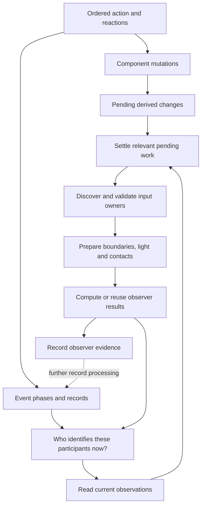
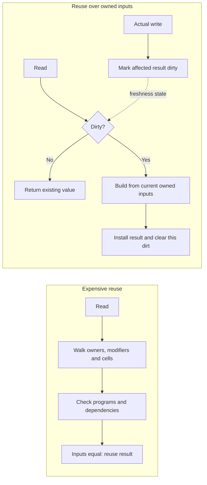
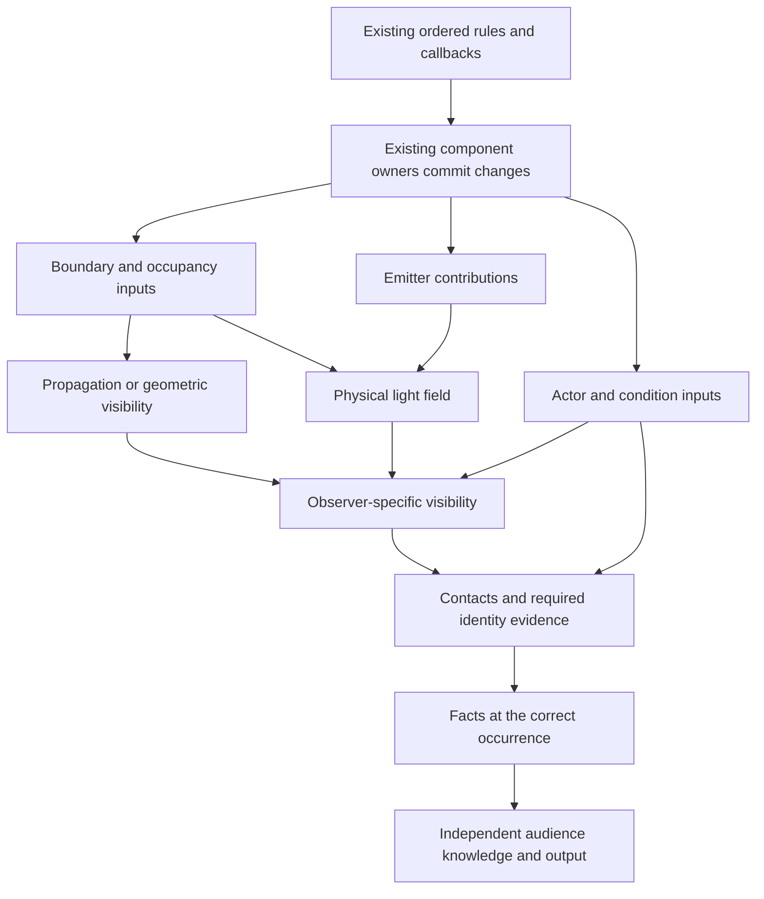
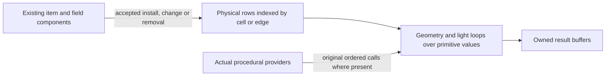
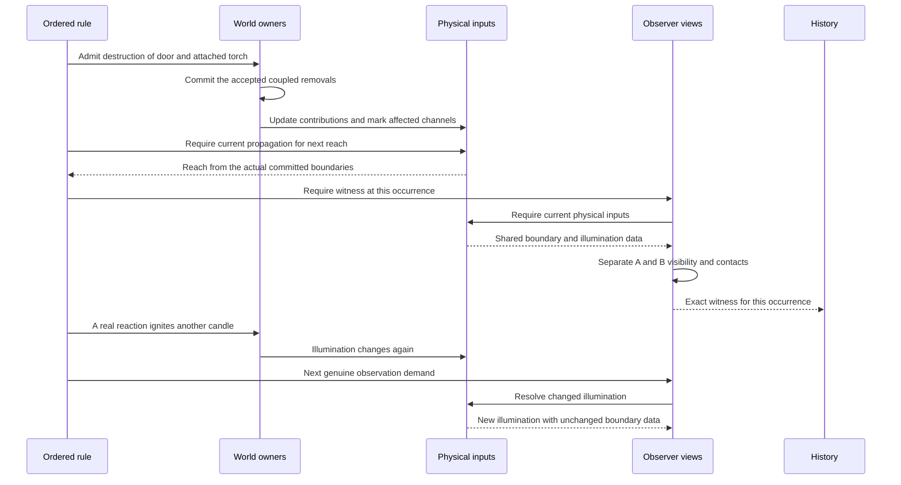
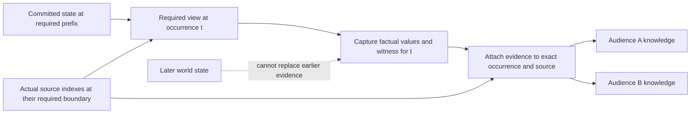
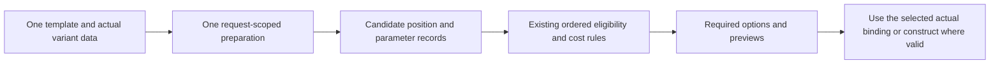
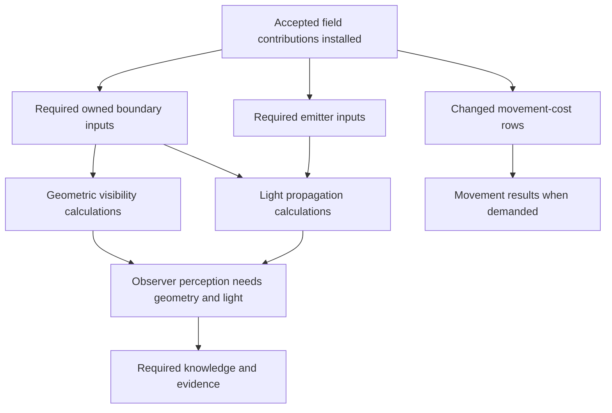
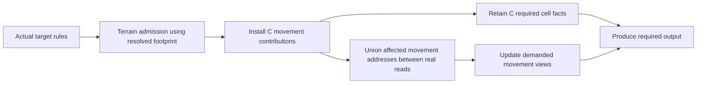

# Engine computation from first principles

The engine needs to make an unchanged answer cheap to obtain. A general scheduler does not establish that property. The proposed alternative is ordered rule execution over existing component owners, with maintained physical inputs, explicitly invalidated derived views, and factual records that consume the appropriate established results. Independent substantial calculations can execute in parallel; the ordinary call stack retains actual sequential dependencies. Its benefit comes from removing repeated discovery, validation and reconstruction, including on cache hits. Batching is an additional opportunity between real reads, rather than the condition on which all performance depends.

This is a theoretical design study. It does not authorize implementation or claim a measured speedup. It preserves actual rules, ordered reactions, RNG, intermediate observations, movement steps, partial failures and existing audience disclosure. Where an arbitrary callback makes a proposed optimization invalid, that limitation is part of the argument.

**1. Start with the amount of information that must change**

An action has several irreducible costs: visiting its actual recipients and invoked rules; changing its actual component values; calculating genuinely new geometry or observations that a consumer requires; recording the required facts; and producing the output actually requested by each audience. A 197-cell terrain change requires 197 actual cell updates if those cells have independent stored values. A doorway opening can reveal an entire room. Neither operation can honestly be promised constant time.

However, a second question about unchanged geometry does not inherently require a second reconstruction of geometry. An HP reduction that leaves the creature alive and does not alter any optical contribution does not inherently require any geometry reconstruction. Recording another phase of an event does not itself move a wall or extinguish a lamp.

The useful unit of analysis is therefore **an input change followed by a read of the affected result**. It is not a target, event, scheduler node, callback or whole action. An action may contain several necessary intermediate states. Many events may also refer to the same state.

For a particular stored derived value `q`, count intervals in which an actual input changes and a consumer subsequently demands the value. A consumer includes automatic engine observation/evidence acquisition at its required occurrence and movement-step boundaries, not just an explicit rule getter or a connected client. The implementation may conservatively invalidate more often than necessary; call its actual demanded dirty episodes `D(q)`. The honest work account is:

`necessary rules + cold construction + sum D(q) * rebuild(q) + mutation/index maintenance + cheap reads + required evidence and output`

Sound invalidation guarantees correctness; it does not guarantee minimal `D(q)`. False-positive invalidations cost real rebuilds. New query arguments also need cold construction. A stream of new discovery candidates therefore needs shared preparation factored out of its loop; dirty flags alone do not make those distinct questions cheap.

The undesirable work includes:

`number of reads * rediscover or validate the entire input graph`

Caching the final arithmetic result does not remove this second term. Nor does adding a task graph around it.

**2. Where the observed work multiplies**

The saved Fireball profile has six targets and four destroyed objects. It contains 72 entries into observer recomputation, 72 boundary snapshots, 102 contact passes, 24 physical FOV calculations and 12 sensory-update terminal constructions. It also contains 8,953 execution queries, 43,503 predecessor checks, 52,410 native-value support checks and 68,250 native-block-hazard support checks. These are instrumented invocation counts; the profile's elapsed timings are not ordinary timings and nested inclusive times must not be added together. [Saved profile](/home/tommaso/.codex/worktrees/causal-execution/dnd_engine/.runtime/causal-execution/connected-acquired-cohorts-v10-fireball-profile.json).

In particular, 72 recomputation entries do **not** mean 72 complete FOV solves. Some results are already reused. The remaining failure includes repeatedly preparing and checking their inputs and recalculating adjacent outputs.

This diagram shows the possible demand cycle, not a claim that every edge executes once for every event. In the source, event metadata requests participant identification, and identification reads an observer's current observations. The execution query path then performs settlement and conflict handling. Thus a bookkeeping request can enter substantial live-world work. [Metadata preparation](/home/tommaso/.codex/worktrees/causal-execution/dnd_engine/dnd/core/events.py:3268), [participant identification](/home/tommaso/.codex/worktrees/causal-execution/dnd_engine/dnd/encounter.py:118), [execution queries](/home/tommaso/.codex/worktrees/causal-execution/dnd_engine/dnd/core/execution.py:227).

The central question is not whether participant identity must be correct. It must. The question is why establishing that correctness repeatedly requires rediscovering the physical world when the relevant inputs have not changed.

**3. A useful cache hit must avoid the input scan**

The decisive change is where the proof of freshness lives. If a query proves freshness by walking all its inputs, a hit can cost nearly as much as a miss. If the owners of those inputs invalidate the result when they change, the clean read needs only a small flag or a bounded set of owner versions.

The required implication is:

`an accepted write changes an input of q -> q is marked invalid before its next read`

For a side-effect-free calculation over owned data, correctness follows by induction. Initially the stored result equals the calculation on current inputs. A write either changes no input of the calculation, leaving the result correct, or invalidates it. A clean read returns the correct stored result; a dirty read computes from current inputs before installing it. No per-read reconstruction of the dependency graph is required. This includes acquisition of the inputs: a supposedly passive builder that calls a mutating provider halfway through does not satisfy the premise. The passive calculation reads established rows without such callouts; this is not a retry-until-stable algorithm for arbitrary callbacks.

This proof does not apply to a callback that increments a counter, reads untracked mutable state, or changes the world. Such a procedure must still execute at its real call point. Its returned answer cannot be reused merely because a world revision is unchanged.

The stored result itself also needs ownership. If a caller can mutate it behind the cache's back, a clean flag no longer establishes correctness. Keep internal derived storage owned and preserve the existing copy/identity contract at its actual consumer boundary, charging any necessary copies. An API that exposes authoritative writable state cannot silently become an immutable cached return value. Its real writes must remain accounted for, or that particular reuse is invalid.

The bound also assumes the working set can be retained. Keep memory proportional to the actual active physical inputs, required observer outputs and required evidence. An undersized generic LRU can repeatedly evict the same inputs and destroy the bound; no constant-memory claim is made for an arbitrarily large world or retained history.

**4. Keep the existing owners and the ordinary call stack**

The synchronous rule stack already expresses that a save must finish before its damage application, that a reaction must return before its parent continues, and that the next breach query follows a committed destruction. Reconstructing those ordinary call relationships as dependency nodes for every scalar read repeats control information already present in the program.

This requires the actual mechanical child operations to complete their accepted writes before returning. If the current graph leaves damage, resource use or destruction deferred, deleting its predecessor checks would read stale components. Put those required effects back in their synchronous order before relying on the stack. Derived dirty addresses may remain pending until demand; required mechanical writes may not silently remain behind the next dependent rule.

Keep rules as ordinary functions. They call the existing component owners. Those owners update their actual state and maintain the indexes needed by readers. The derived systems use direct prerequisite calls where needed: an observer visibility calculation can require current light and boundary data. A real dependency between stored values remains a dependency; the argument is against reconstructing a general execution graph for each lookup, not against representing actual data dependencies.

These boxes are data and existing responsibilities, not instructions to create new manager classes. The diagram is the passive dependency portion. Effectful procedures remain on the ordered rule side; their execution cannot be silently moved into an earlier preparation pass.

A read of Fireball propagation needs propagation inputs. It need not demand HUD construction, discovery candidates or every observer's full presentation. Conversely, a callback that actually reads full current senses needs the corresponding current view. The interface should express the question being asked instead of automatically demanding every neighboring product.

Point LOS is not interchangeable with perception. Lighting, sense modes, concealment, identity and existing knowledge can change the answer. A read that promises the complete senses mapping must continue to supply that mapping. Direct native API return is also a freshness boundary when callers can inspect raw senses immediately. Required views must be current there; lazy evaluation cannot silently leave public dictionaries stale. Opaque callbacks with raw reads likewise retain their required current-state behavior after writes.

The deliberate departure from the previous plan is to remove dynamic scheduling/conflict reconstruction from ordinary reads whose sequencing is already supplied by the stack. Existing public entry points can still call one authoritative domain implementation. Keeping one execution path does not require allocating or checking an execution node for each field. Maintaining old and new competing mutation implementations would not be this design.

**5. Separate dependencies that actually differ**

| Accepted change | Inputs that can change | Work not implied by that change alone |
| --- | --- | --- |
| HP loss without death or a changed physical contribution | Health and the relevant factual values | Boundary geometry, light transport, full FOV |
| A torch is extinguished | Its illumination contribution and affected observer light/contact results | Unchanged wall geometry |
| A door is destroyed | Its actual boundary, support, occupancy and attached emitter contributions; affected propagation and illumination | Unrelated observers outside a conservative influence domain |
| Difficult terrain changes movement cost only | Movement and applicable hazard/path results | Optical geometry |
| An observer gains a different sense | That observer's mode-dependent result and contacts | Rebuilding every boundary object's physical description |
| A new event source is indexed | Source/context-sensitive procedures and required evidence | Physical geometry merely because the event cursor advanced |

These are conditional dependency statements, not assumptions that every damage or condition operation is harmless. Death, transformations, attachment changes or reactions may commit additional changes. Those changes must invalidate their actual dependents.

The current engine already has channel revisions and observer dependencies. The theoretical correction is to make those owned facts sufficient for the relevant read, instead of surrounding them with another recursive validation of all providers. Adding more revision fields without removing the scan would repeat the failure.

There is also a data-layout issue. A physical inner loop should consume the needed physical rows, rather than repeatedly navigate `Tile -> program -> conditions -> contribution owner -> modifier -> value`. Existing component owners can maintain a compact index of boundary contributions and light values, just as a spatial index is maintained alongside entity positions. This is a computational index with one update owner, not a second independently editable world.

Arrays, ordinary maps and sparse contributor lists are sufficient vocabulary. There is no need for an object hierarchy per channel, a serialized rule language, or a per-cell capability interpreter. The representation must keep the current direction/support distinctions; this is not a new spatial model. Dynamic provider results are not silently promoted into these persistent rows.

Only the data being newly shared needs the ownership proof. An arbitrary value or hazard procedure that continues executing directly at its established point needs no new certificate declaring it safe to cache. Replacing a recursive support scan with a universal capability registry would leave the same conceptual problem in another place.

**6. Pay for invalidation without moving the same product to writes**

Mutation-owned invalidation is not free. If every cell write walks every observer and every cached candidate, the same multiplication has merely moved from reads to writes.

Use ordinary spatial membership indexes and small dirty sets. Accumulate changed positions/channels within an interval where no consumer, including automatic historical observation, needs an intermediate result. The existing owner path must capture any required witness before the next conflicting transition; this does not depend on a rule calling a getter. Find affected existing observers through conservative spatial envelopes. Multiple writes can insert the same observer or source into a set; the expensive refresh occurs when demanded. Account for the index-maintenance and set-insertion costs as real work.

Concretely, existing bulk owners can add changed cell/channel addresses to a pending set and set one pending bit. At the next relevant demand, route that union through the spatial index, mark affected existing views, and call the needed prerequisite functions directly. A read with no pending relevant changes and a clean local view checks bounded metadata. The set holds changed addresses, not executable jobs, conflict proofs or predecessor nodes. Every required intervening observation still ends the interval.

Invalidation must cover possible influence, not just what is currently visible. Opening a door may reveal a lamp and a room absent from the old visible set. A moved large object affects its entire old and new support, not merely its anchor. Coarse region indexes can be preferable to perfectly precise dependency tracking: precision is useful only when the scans it removes outweigh the cost of maintaining it.

Persistent views should correspond to real consumers, such as the existing observers. Discovery preparation can be request-local. Maintaining a permanent view for every potential action/target/observer combination would create another large product and memory problem.

**7. Share physical facts without sharing observer verdicts**

Consider a door supporting a torch, observed by A with ordinary sight and B with darkvision. This is an illustrative causal trace, not a claim about the exact number of necessary solves in the saved Gallery case.

Both observers can consume the same committed boundary descriptions and the same applicable physical illumination. They cannot share one visibility Boolean: their senses differ. If the candle is ignited between their actual reads, they may also need different illumination states.

For a coupled accepted destruction, callbacks must not observe the door removed while its already-required attached emitter remains. That is a local mutation-owner responsibility. It does not require a generic transaction system or whole-action rollback. If the authored rules require a genuine decision between two changes, those are separate transitions and the intermediate state remains observable.

An intermediate reaction that tests LOS forces the relevant current result. Therefore four destructions are not automatically one rebuild, and an entire action is not automatically one batch. The useful bound is the number of demanded input states for each result.

For a concrete cost illustration, start with two observers and their views already current. Four successive occurrences require identity evidence: nonlethal HP loss; the door-and-torch destruction; another occurrence with unchanged physical inputs; and candle ignition. All eight observer witnesses remain. Suppose `P` is preparation of common boundary descriptions, `L` a physical-light update, `V` one observer's changed-view evaluation, and `C` a genuinely source-sensitive procedure per witness.

| Cost in this illustrative sequence | Repeated read-time preparation | Owned-input design |
| --- | --- | --- |
| Boundary description preparation | Up to `8P` just to establish freshness | `P` after the actual boundary change |
| Physical light | Required updates, possibly rediscovered per reader | `2L`, after destruction and ignition |
| Observer-specific changed views | Required updates | `4V`, for two observers at two changed states |
| Source-sensitive procedure | `8C` | The same `8C` |
| Identity evidence | Eight witnesses | The same eight witnesses |
| Maintenance/control | Input scans and repeated execution conflict checks | Actual index/dirty maintenance and cheap reads |

This example assumes both transitions actually change illumination and both observers' current perception, and that the named procedures do not themselves mutate further inputs. It is not a prediction of the Gallery call counts. Its purpose is to identify the eliminated `7P` term without pretending to eliminate real procedure calls or intermediate evidence. Rebuilding a fingerprint of all boundaries on each read would restore `8P`; invalidating geometry for candle ignition would introduce another unnecessary `P`.

**8. Overlap requires contributor ownership, not toggling Booleans**

Suppose two sources illuminate the same cell. Removing one must not set the cell to dark while the other remains. Similarly, removing one overlapping terrain or blocking contribution must leave the others intact.

Ordinary solutions are source-to-covered-cell indexes and per-cell contributor collections or suitable aggregates. For a fixed small light-level domain, per-level counts can produce the aggregate; for richer combinations, recompute the aggregate from that cell's remaining contributors. Boundary contributions retain the existing direction, height and support distinctions. A global scan of every source is not required merely to remove one known source.

Changing a blocker also affects surviving emitters. Select them by their possible propagation envelopes intersecting the changed boundary, rather than only their previously illuminated cells. Otherwise opening a door could fail to propagate a surviving lamp into the newly exposed room. The old and newly computed contributions both participate in updating the aggregate.

The table stores physical contribution data whose installation, replacement and removal are actually owned. It does not store the result of an arbitrary stateful hazard or visibility callback as if it were a permanent physical fact. Even membership/layout sharing needs correct updates if a callback changes later inputs.

Preserving callback count alone is insufficient. If a boundary getter returns closed on its first call and open on its second, an observer callback between those calls can distinguish evaluating both getters up front. Keep each call at its original conditional traversal point. Likewise, a hazard predicate can insert a condition into a later tile during a scan; a sparse membership snapshot taken at scan entry would miss that condition. Maintain the original live traversal behavior for those procedures. Preparing data-owned rows must not silently hoist, deduplicate or rearrange authored calls.

**9. A 197-cell storm need not become 197 full observer jobs**

Installing a terrain field requires its real cell values, membership and records. Those are proportional to its coverage. Occupied-cell rules, dousing, saves, concentration and later entry/turn effects retain their actual order and invocation counts.

If a region of changes has no intervening consumer of the derived view, including required observation/evidence, union its dirt and calculate the affected result at the next demand. A movement-cost-only change should not invalidate optical geometry. If an occupant's actual callback reads the changed view halfway through, settle the required prefix and continue afterward. Do not invent simultaneous installation if the existing rule exposes each intermediate cell.

Even if all 197 intermediate cell states are observable, that does not imply 197 complete scene rebuilds. For a cell-local derived movement value, update the changed cell's derived value and preserve the required fact. This is ordinary incremental view maintenance. Not every result has an equally cheap delta: a changed wall can affect a broad visibility region, so its geometry calculation may need a larger rebuild. The dependency and output size determine the work, not the existence of an event.

This separates three costs: required cell writes, required rule evaluations, and derived calculations. Only the third can be combined across a compatible interval. The early Sleet improvement from distinguishing cost-only terrain supports the value of this dependency distinction; it does not prove that universal dispatch machinery is necessary.

**10. Recording the past must not reconstruct it from the final world**

A flash followed by darkness can produce the same final physical state as no flash, while observers learned something in the intermediate state. Final-state-only publication is therefore incorrect, even if no rule explicitly queried sight between flash-on and flash-off. The engine's observation obligation is itself a consumer. An event that needs earlier sight consumes or captures the correct earlier result. It cannot be reconstructed later from whichever view is current then.

Current perception and accumulated knowledge are different mathematical objects:

`V(t) = perceive(physical inputs at t, observer configuration at t)`

`M(t+1) = advance_memory(M(t), V(t), occurrence at t)`

The first equation describes only the passive portion with fully owned inputs. Its unchanged value can be reused. The second is a state transition that may still be required at a new occurrence. A clean geometry flag does not skip memory, contact transitions, evidence or disclosure. Those costs remain proportional to the actual required occurrences and participants; identical physical inputs do not imply identical historical knowledge.

Source indexing and evidence attachment are distinct. Some procedures require an actual source index before they can compute the evidence; other factual preparation precedes storage of its own result. Keep those original prerequisite orders and the required sibling-index visibility. The diagram does not impose a universal rule that all indexing follows observation, and no future/fake cursor stands in for an unavailable source.

Once captured, factual evidence is data. Replaying or copying it should not ask the live engine to rediscover who could see it. Maintain ordinary event/lineage indexes and return direct results from the operation that produced them instead of scanning unrelated history to infer what just happened.

Historical event identity and late causal attachments may require the existing Event objects to remain. Stable payload sharing need not replace them with a new facade. Retained records must not accidentally retain the entire invocation's scheduling graph. Independent audience knowledge remains separate; a shared physical observation does not grant party-wide knowledge or justify sharing mutable public state.

Authored copy hooks are a genuine constraint. An earlier hook may mutate a later object. Freezing that later value early changes behavior. Share only genuinely owned stable payloads; keep required hook calls and mutable consumer copies at their original observation points. A custom universal copier is not a prerequisite for fixing physical preparation.

**11. Discovery has a different multiplication and a different ordinary solution**

If C candidate positions each deep-copy an action graph containing G objects, the internal preparation costs approximately C times G before much useful eligibility work occurs. The candidate itself usually differs in a few parameters.

Use small candidate records referencing shared template/variant inputs where the existing rules consume those explicit inputs, or after a concrete producer interface migration. This is ordinary parameterization and loop-invariant preparation, not a new action interpreter. A candidate still gets any genuinely target-dependent or effectful evaluation required by the existing semantics.

Some providers require an independent mutable action or shape during each candidate evaluation, including observable copy hooks. Those candidates retain that binding/copy at the original point unless its contract is explicitly changed. A provider may also return mutable candidate state or a continuation that must survive selection. Retain the actual result and identity; do not rerun the provider or rebuild from a subsequently changed template. Sharing immutable inputs can remove discarded graph copies without assuming every action is reducible to template-plus-coordinate. Mutating the shared template or inventing a reflective proxy would recreate correctness problems.

For example, an eligibility callback that increments a counter inside its action and accepts only counter value one accepts every independently copied candidate, but only the first candidate if the template becomes shared mutable state. Parameterization requires stable shared inputs plus properly isolated candidate-local state. No universal copy-on-write or field interception is implied. Where the existing interface requires that mutable graph, its cost remains until that concrete producer is deliberately changed.

Shared inputs must retain their actual capture point. If a provider mutates resources during enumeration, later live resource checks cannot reuse an earlier balance. If the API asks for 11,527 options, producing those options has an unavoidable output cost. Omitting options or silently deferring them would be a product/API change. The proposed saving is the discarded rich graph behind each option, not a promise that complete output is free.

**12. The semantic limits must be explicit**

| Counterexample | Consequence for the theory |
| --- | --- |
| A getter increments a counter and returns alternating answers | It is a procedure, not a reusable value. Preserve calls and order; share only its passive surrounding inputs. |
| A predicate installs a condition into a later tile during traversal | The later tile must see it. An entry-time sparse membership snapshot is stale. |
| A field used by a cached result can be changed without its owner observing the write | The invalidation proof fails. Do not cache that dependency or pretend a membership-only version covers it. |
| A provider changes an occluder and recursively requests current senses | A generic dirty flag does not resolve reentrancy. Preserve the concrete owner boundary and established failure/result behavior; no invented global fixed point. |
| A door opens into a previously unseen room | Invalidate by possible influence, not old visible membership. A large newly visible output can require real large work. |
| A hazard depends on the newly indexed source although geometry is unchanged | Reuse the physical data; still evaluate the actual contextual procedure at that source. |
| Two light or terrain contributions overlap | Remove the named contribution and retain the others; never clear a shared Boolean blindly. |
| An observer sees a transient event before the world returns to its old state | Preserve evidence at that intermediate state. Coalescing to only the final value is invalid. |

The important scope restriction is not to respond to these cases by migrating every mutable Python field into a universal tracking framework. Establish the ownership proof for concrete data already governed by the geometry/light owners. Other procedures keep their required execution behavior. A stronger purity or API restriction would be an explicit semantic change, not an optimization to sneak into implementation.

**13. What makes this substantively different from the failed approach**

The previous plan already used words such as ownership, dirty work and shared preparation. Reusing those words is not an improvement. The difference must be visible in which work disappears:

| Previous failure mode | Required structural difference |
| --- | --- |
| A cheap query performs access/conflict reconstruction across active frames | Ordinary local reads inside an established owner boundary; use the synchronous stack for already-sequential control |
| A cache hit walks providers and capability graphs to prove safety | Accepted writes invalidate concrete owned derived inputs; clean reads inspect bounded metadata |
| Grouping requires proving an entire authored procedure compatible | Precise invalidation benefits even eager/current callbacks; optional grouping saves additional work between real reads |
| A new event source causes broad physical work | Source/context dependencies remain distinct from physical mutation dependencies |
| Each observer reconstructs the same physical input descriptions | Share actual committed physical rows; preserve separate observer-dependent evaluation |
| A missing selector on unrelated content blocks any useful loaded result | Data ownership is established at concrete affected component boundaries, without requiring a universal copy/query-program migration as the performance mechanism |
| A small improvement requires another framework to classify all other frameworks | Existing indexes, arrays/maps, small dirty sets and direct functions perform the work; no new universal certification layer |

A support flag is insufficient if the fields used to decide support can mutate independently. Precomputing that flag without owning those fields merely creates a stale cache. Equally, moving the recursive support scan to every write is not a win unless the actual workload makes that maintenance cheaper. For each concrete result, the saved rebuild/proof work must exceed write maintenance, clean-read checks, storage and copying.

In symbols, suppose `R` reads each spend `S` discovering unchanged inputs, while the proposed approach spends `h` checking bounded metadata per read and `m` maintaining indexes per relevant write, across `U` writes. Charge extra initialization `I` and false-positive rebuild work `F`. Holding the genuinely required calculations and procedure calls equal, the proposal saves time only when:

`R * (S - h) > U * m + I + F`

This is the missing cost argument, not a benchmark prediction. Shared preparation can reduce `S`; local invalidation reduces `F`; removing per-lookup execution graph reconstruction reduces control work. If maintenance walks the same complete graph as the old read and there are as many writes as reads, merely relocating the check establishes no saving.

The old plan explicitly said cheap reads should stay inline and rejected overhead exceeding saved work. It also put typed service/routing/graph infrastructure first, real concurrency fourth and completion of the performance packages sixth, while requiring all logical query families to migrate. Performance packages were allowed to progress alongside owner migration; they were not entirely postponed. Nevertheless, completing routing or demonstrating concurrency does not establish that the dominant read-time products have disappeared. The review failure was accepting those warnings and coverage tables as a substitute for demonstrating which product disappears in the first connected result. Uniform routing and correct causality are properties; neither is a performance proof. [Original requirements and implementation order](/home/tommaso/.codex/worktrees/causal-execution/dnd_engine/agent_docs/plans/ENGINE_ARCHITECTURE_PLAN_2026-10-16.md:447).

**14. What this theory can and cannot establish**

It establishes a way to make computational work depend on actual relevant changes and demanded outputs, rather than incidental event count and repeated owner discovery. It does not establish a 40 ms runtime. The size of real geometry changes, output, procedural evaluations and current implementation constants still matter.

The initial ordinary Fireball baseline contained about 718 ms of native work and 47 ms of both-audience publication. Eliminating all of that publication would still leave the dominant native cost. Consequently public conversion improvements, while useful, cannot substitute for resolving native amplification. [Baseline](/home/tommaso/.codex/worktrees/causal-execution/dnd_engine/.runtime/causal-execution/production-fireball-ordinary-v1.json).

The strongest theoretical falsification is simple: if reading an unchanged owned result still traverses its world/provider graph, the proposed design has not delivered its central property. If a write must touch every potential observer/candidate combination, the work has merely moved. If records trigger new physical work without a relevant changed input or an actual procedural requirement, history and computation remain coupled. If compatibility with arbitrary hidden side effects is required, no cache or scheduler can safely erase those effects by assumption.

Four thought experiments make the argument falsifiable. Add an inert level of nested rule calls: a scalar read must not acquire more predecessor-graph work merely because the stack is deeper. Change an owned boundary without emitting an event: its next relevant result must still update. Remove a blocker at the old visible frontier: the newly exposed region must still be discoverable. Append a late child to an old event: the existing parent lookup must see it without rewriting all prior payloads. These expose control duplication, publication-based invalidation, incorrect spatial locality and historical graph replication respectively.

Independent coarse calculations can use a normal bounded executor if its transfer/join costs are worthwhile. Creating futures or scheduling nodes for dictionary reads is not a route to cheaper gameplay. Removing duplicated work and shortening the remaining chain of dependent calculations are both performance objectives; neither requires serializing independent branches.

**15. Area effects can have parallel branches without a general execution graph**

One effect can establish several facts: health changes, a new field, movement costs, obscuration and light changes. Coherent installation, simultaneous game meaning and parallel CPU execution are distinct properties. An accepted multi-component transition must be complete before a callback that is entitled to see that complete transition. Its physical writes can be cheap owner-local work; independent calculations over their established inputs can execute concurrently.

The geometry and light branches can overlap where they actually consume stable data without callbacks. Movement work has no dependency on that join unless an actual consumer introduces one. A record requiring multiple results joins those results at its own boundary. An unrelated movement query does not wait for every observer, HUD and history consumer. These dependencies can be expressed by ordinary domain functions and a small number of coarse worker calls; no runtime graph is required for every scalar lookup.

The ordinary serial target loop is not itself proof that all target mathematics must remain serial. Independent calculations over already accepted inputs can overlap. Actual saves, reactions, resource use and destruction can introduce dependencies, so whole `receive_damage` or `recompute_observer` methods are not automatically worker jobs. Fireball's later breach stage needs the newly committed geometry. If the rules instead establish a genuinely simultaneous group, the owner can process that group coherently; preserve only actual observable order, not an incidental loop as a permanent requirement.

Two overlapping fields can calculate their independent contributions concurrently, then the affected cell owner combines them. They must not race writes to one aggregate or erase each other's contribution. Each domain retains its actual area admission: a field with intermediate vetoes or observations is not silently converted into one indivisible cast.

The wall-clock opportunity is concrete. For independent substantial jobs that fit the available workers, their compute portion approaches the longest job rather than their sum; preparation, transfer, joining and installation remain charged. Tiny cell assignments usually belong in a tight bulk loop because scheduling each assignment adds more work. Parallelism should shorten useful computation after its inputs are shared, and independent branches must not acquire artificial joins.

**16. Ice Storm's latency is not justified by its ordering constraints**

The code resolves target saves/damage and calls terrain installation from `_finalize_aoe`. The terrain owner loops admitted positions, installs a walking-cost contribution, invalidates movement state and retains each changed cell's after-value. [Ice Storm finalization](/home/tommaso/.codex/worktrees/causal-execution/dnd_engine/dnd/spells/evocation.py:3559), [terrain installation](/home/tommaso/.codex/worktrees/causal-execution/dnd_engine/dnd/spatial/area_conditions.py:1382).

Those operations explain required behavior. They do not justify hundreds of milliseconds or seconds. A saved production run recorded 2,628.5 ms total, including 2,453.2 ms native. A later saved v3 run recorded 619.7 ms total, including 436.9 ms native and 178.7 ms audience publication. These are historical runs, not a new measurement of the current checkout or proof of identical complete semantics. Both the remaining native work and publication need an explanation in actual computation. [Production run](/home/tommaso/.codex/worktrees/causal-execution/dnd_engine/.runtime/causal-execution/production-ice-storm-ordinary-v1.json), [saved v3 run](/home/tommaso/.codex/worktrees/causal-execution/dnd_engine/.runtime/causal-execution/native-value-boundaries-icestorm-ordinary-v3.json).

For `N` actual recipients and `C` admitted cells, the useful work account is target-rule work, one footprint calculation where its inputs are shared, `C` actual cell contributions and records, necessary affected-view calculations, and actual output. This is not a claim that every rule or view is constant time. It says those costs must be charged once at their real consumers, without adding a complete provider/source/observer traversal for each scalar assignment.

The terrain's movement-cost contribution alone does not require recomputing lighting or FOV. Visible field presence, hazard knowledge and any additional actual changes retain their own dependencies. If there are real intermediate consumers, retain those consumers while reusing unchanged physical data; a requirement to preserve a cell fact does not itself demand a full scene solve.

The concrete removal targets are repeated source/input discovery within that cell loop, repeated evaluation of unchanged movement channels when capturing a cell's after-value, repeated fanout over the same affected observers, and publication that reconstructs already established facts. The current source already has buffering and movement-only hints; merely adding those labels again is insufficient. The relevant source-group and after-value paths are [here](/home/tommaso/.codex/worktrees/causal-execution/dnd_engine/dnd/core/gridmap.py:2281). This source inspection identifies work to factor and bound, not a measured attribution of the current milliseconds.

The theoretical rejection criterion is therefore direct: a plain difficult-terrain region must not become `C` repetitions of whole-world discovery or complete observer refresh. Ordered target resolution and preserved reactions do not require that multiplication. Their existence is no defense of the observed latency.
